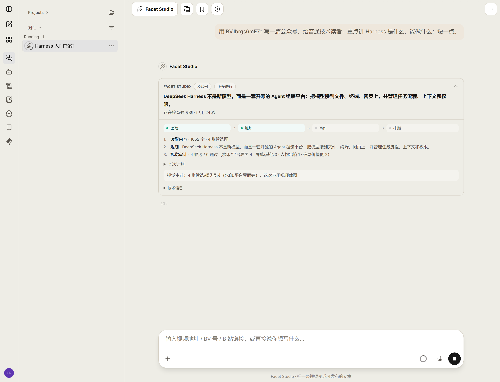
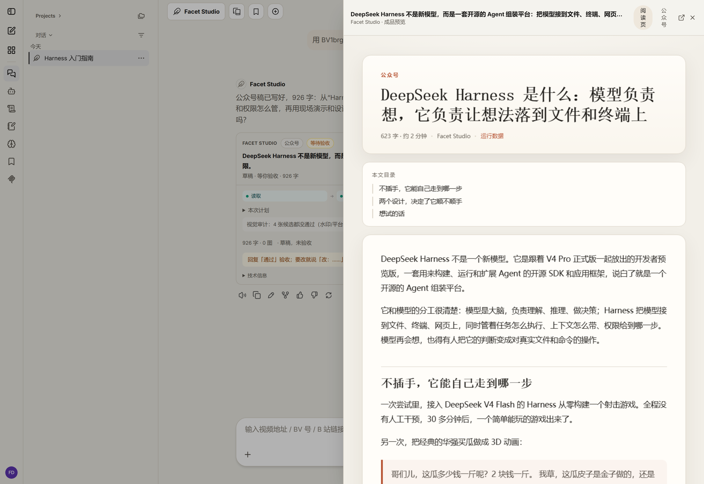
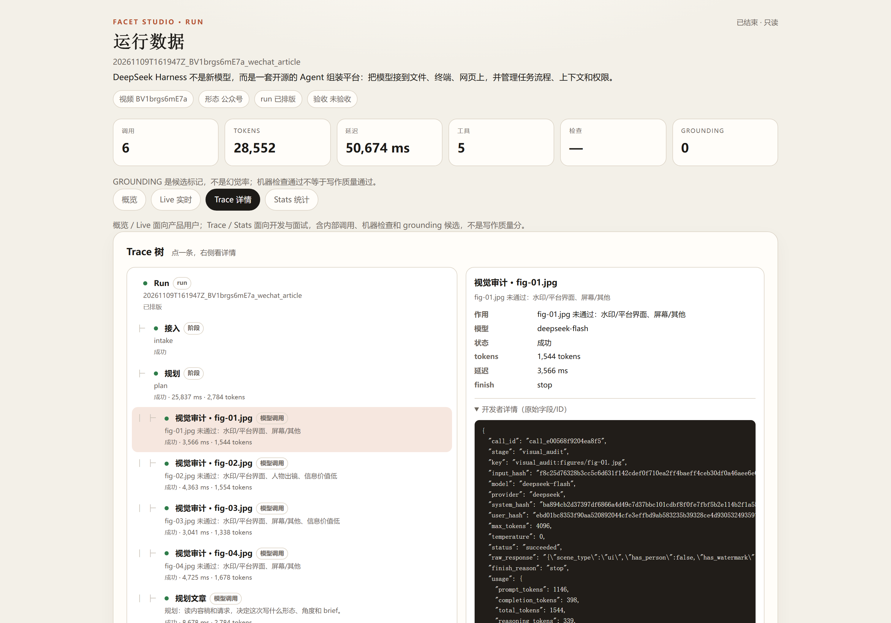
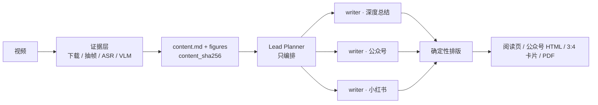
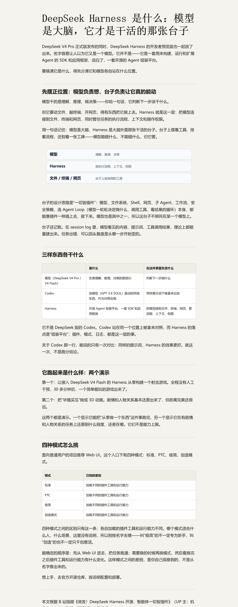

# Facet Studio

**把一条视频，写成可发布的成品。**

给一条视频和写作要求，Agent 按需写成**深度总结 / 公众号 / 小红书**，在聊天里预览、修改、验收；成品是排版后的页面、卡片或 PDF，不是一段裸文本。

<p>
  
  
</p>

| 运行中：聊天里一张运行卡 | 成品：右侧预览 | 运行后：Trace 可下钻 |
|---|---|---|
|  |  |  |

> 截图来自开发机的最新验证 run（公众号，926 字，等待验收；4 个候选帧 0 通过，所以 0 图）。预览页的 623 字是阅读页口径，run 卡的 926 字是 writer 输出口径；运行数据页的“延迟”是 LLM 调用合计，不是墙钟；该 run 不在固定评测集里，所以“检查”显示为 —。

## 它解决什么问题

内容团队和创作者经常有一条视频，但没时间把它变成公众号、小红书和长文。常见做法是“转写 → 让模型总结 → 手工排版”，得到的是**一段概括**，不是能直接发出去的成品。

Facet Studio 把这条链路做成一个工作台：

| 输入 | 过程 | 输出 |
|---|---|---|
| 一条视频 + 读者/长度/语气/必须包含或避免的要求 | 一次内容编译 → 规划 → 一次 writer 成稿 → 确定性排版 | 阅读页 HTML / 公众号富文本 / 小红书 3:4 卡片 / PDF |

**核心是把同一份内容稿写成不同平台可发布的形态，而不是每个形态重新处理一遍。**

适合：有视频素材、需要公众号/小红书/长文多平台内容的创作者和小团队。
不适合：纯影视/音乐等 ASR 稀疏内容，或需要大量外部事实核查的严肃报道。

## 为什么是“工作台”，不是一次性生成

- **同一份内容稿复用**：视频只编译一次，得到 `content.md + figures + content_sha256`；三种形态共享同一份内容和图，不为每个形态重新看视频。
- **每个形态一次 writer**：Lead Planner 只决定“写什么、给谁、什么角度”，正文由一个 writer 一次写完；没有 editor/checker 多轮改稿。
- **Writer 不知道来源**：只拿到“这件事的完整内容”，正文不出现“视频里说/本视频”这类工作痕迹；内容稿保留结构、数字、例子和边界。
- **成品优先**：默认给排版后的页面/卡片/PDF；Markdown 只是可编辑源，不是最终交付。
- **人工验收是唯一发布门**：不自动发布；每次 run 都能看到读了什么、花了多少、卡在哪。

## 一条内容稿，三种形态



同一份内容稿可以复用到多次请求：第二次写另一种形态时，只跑 plan + writer + typeset，不重读视频。

## 视觉不是“多放几张图”

这个项目的视觉策略是**克制**：

- **关键帧默认 0，最多 1**：只有不可替代、画面干净、与段落严格对应、权利清楚的帧才用；水印/UI/人物/信息价值低都会被拒绝。
- **先表格、代码、清单、SVG**：结构、流程、对比、数字优先用可读的载体；Writer 只写一句关系，SVG 由本地确定性渲染，不让模型写 HTML/LaTeX。
- **没有合格素材就不放图**：降级为文字/表格/卡片，不硬塞视频截图。
- **图注默认不加**：需要“看哪里/说明什么”时写进正文或图内标注。



> 另一个已验收 run 的成品：SVG 关系图 + 2 张表格，不是视频帧。最新验证 run 是 **926 字 + 0 图**——4 个候选帧都没通过视觉审计，系统选择不放图；公开 demo 是 793 字 + 1 张文字封面。

## 可观测：每次请求都能复盘

每次用户请求是一个独立 run：

- 聊天里只显示一张**运行卡**：阶段轨、当前步骤、计划、视觉审计结论、字数/卡片/关键帧、验收状态。
- `/runs` 看板：最近 runs、p50/p95、tokens、error、checks、grounding candidates。
- `/runs/<run_id>`：Live SSE / Trace / Stats；Trace 可下钻到 stage、LLM call、tool span、decision、token/latency，以及原始调用字段。
- 人工验收写入 `publish_review.json`；未验收的产物标记为草稿，不静默变成 approved。

评测只测**运行数据、产物合同、workflow 轨迹、grounding candidates**，不评写作质量；`pass@1 / pass@k = null`。详见 [evals/product_v1](evals/product_v1/README.md)。

## 3 分钟跑起来

```bash
# 1) Python 依赖（3.11/3.12）
pip install -r requirements.txt

# 2) 配置
cp .env.example .env
# 填入 DEEPSEEK_API_KEY；跑新视频再加 DASHSCOPE_API_KEY

# 3) 测试（不依赖 data/、runs/ 或 API key）
PYTHONPATH=src PYTHONUTF8=1 python -m pytest tests

# 4) 预览 / 运行数据
PYTHONPATH=src python -m facet_studio.preview_server
# http://127.0.0.1:8765/runs
```

完整聊天壳（LibreChat + Mongo + preview）见 [integrations/librechat](integrations/librechat/README.md)。新视频接入：

```bash
pip install -r requirements-evidence.txt
PYTHONPATH=src python -c "from facet_studio.ingest import ingest_source; print(ingest_source('https://www.bilibili.com/video/BV...', profile='fast'))"
```

## Demo 与样本

- [examples/demo](examples/demo/README.md)：一份真实本地 run 的公开样本——793 字小红书 + 1 张文字封面卡 + 脱敏 run/trace 摘要；**不含任何视频帧**。
- [docs/demo-script.md](docs/demo-script.md)：3 分钟 demo 分镜（截图版，不录架构页）。
- 更多截图：[初始界面](docs/assets/ui-initial-agent.png) · [Live/SSE](docs/assets/run-overview-new.png) · [Stats](docs/assets/run-stats-new.png) · [完成卡片](docs/assets/run-card-done.png) · [已验收 Trace 15/15](docs/assets/run-trace-detail.png) · [决策](docs/assets/run-decision.png)。

## 评测（不是写作质量分）

固定 10 cases / 9 unique runs：

| 指标 | 结果 | 说明 |
|---|---:|---|
| contract | 10/10 | 产物合同 + 机器检查 |
| trajectory | 30/30 | 阶段/顺序/HITL/usage 等过程断言 |
| error | 0 | 固定 cases 的 failed/partial |
| manual acceptance | 9/10 | 用户验收；不是质量分 |
| p50 / p95 | 52.4s / 92.7s | plan+write，不含视觉审计/排版/排队 |
| pass@k | null | 没有 judged trials，不伪造 |

`grounding` 是 candidate flags（9 artifacts / 16 candidates），不是幻觉率。人工验收是唯一发布门；未验收 run 不自动 approved。

## 设计取舍

| 决策 | 为什么 |
|---|---|
| planner-executor，不是 supervisor | Planner 只决定“做什么”；writer 一次写完，避免第二作者改稿和上下文漂移 |
| 一个产物一次 writer | 减少 loop、保持文风一致；修改 = 新请求 + 新 writer，不是 editor 改稿 |
| Writer 不知道来源 | 正文不为“解释视频”服务，而为读者理解服务；来源只在需要时自然出现 |
| 关键帧极紧 | 视频帧常有水印/UI/人物/版权问题；没有合格帧就用表格/SVG/文字 |
| MCP + LangGraph | 工具是产品接口，LibreChat 和外部 agent 都能复用；状态/checkpoint/interrupt 是产品需要的 |
| 不做 RAG/向量库 | 内容稿就是上下文；没有真实检索 consumer，不硬造 |

## 代码结构

- `src/facet_studio/mcp_server.py` — MCP 工具层
- `src/facet_studio/workflow.py` — LangGraph 六阶段工作流 + checkpoint + interrupt
- `src/facet_studio/writing_v4/` — planner / writer / skills / visual audit
- `src/facet_studio/observability.py` + `observability_ui.py` — trace / 运行卡 / `/runs`
- `src/facet_studio/evals/` — deterministic harness + grounding candidates
- `src/facet_studio/evidence_layer/` + `ingest.py` — 新视频接入
- `integrations/` — LibreChat / 小红书卡片 / PDF
- `skills/writing/` — long_article / wechat_article / xiaohongshu_note

## 已知边界

- 本地 demo，不是生产部署；没有真实用户、线上 A/B、QPS/留存数据。
- 没有 judge 校准、真人 reader test、pass@k；不伪造写作质量分。
- 没有公网鉴权/限流/成本上限、完整模型配置 UI、用户画像记忆。
- 不自动发布；不 commit/push；不读 `data/cookies/`。
- 视频/帧/ASR/cookies、`runs/`、内部交接、历史含 B 站帧的 `deliverables/` 均不入库；示例不含视频帧。

## 文档

- [产品定义](docs/product-v1-chat-studio.md) · [架构](architecture.md) · [写作引擎](docs/writing-v5-architecture.md)
- [可观测](docs/observability-2026-11.md) · [评测](evals/product_v1/README.md) · [证据层](docs/evidence-layer-2026-11.md)
- [运行时证据](docs/runtime-evidence-2026-11-09.md) · [复用栈与 license](docs/reuse-stack-2026-11.md) · [全部文档](docs/README.md)

## License

代码 MIT，见 [LICENSE](LICENSE)；第三方依赖/素材见 [THIRD_PARTY_NOTICES.md](THIRD_PARTY_NOTICES.md) 和 [examples/NOTICE.md](examples/NOTICE.md)。
