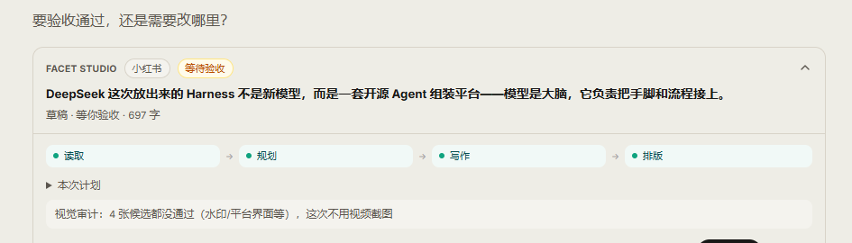
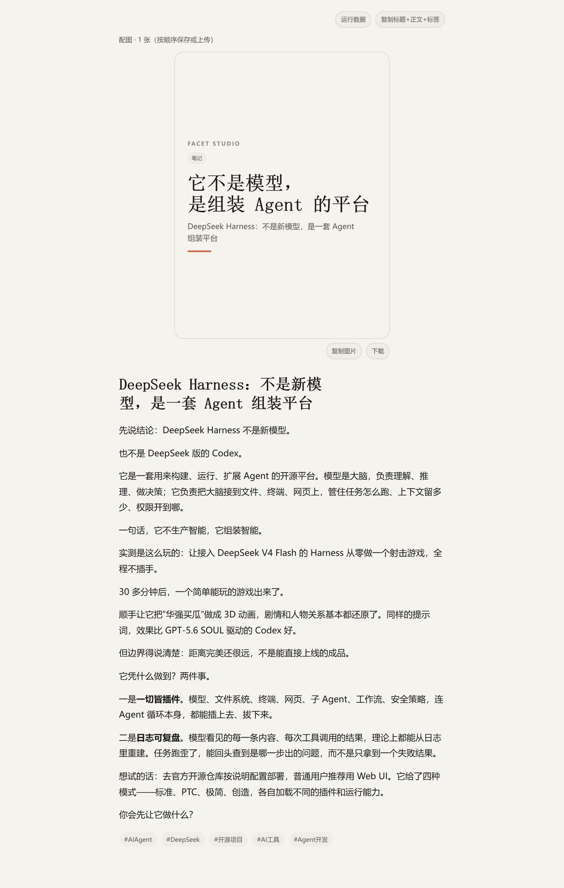
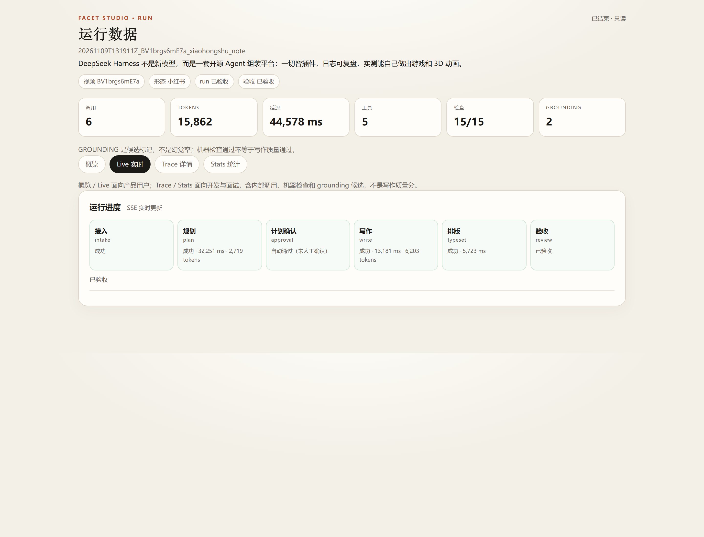

# Facet Studio — 聊天式视频内容工作台

把一条视频变成可发布的文章/笔记：用户在聊天框里给视频和写作要求，Agent 按需写一种形态（深度总结 / 公众号 / 小红书），在聊天里预览、修改、人工验收。

**不是**一次生成所有形态的 bundle 工厂，也不是“视频转写 + 摘要”工具；产物是独立文章/笔记，不是 coverage dump。

| 聊天里的单张运行卡 | 排版后的成品 | 运行数据 / Trace |
|---|---|---|
|  |  |  |

> 截图来自开发机；聊天卡为较早 UI 示例（697 字），最新 793 字样本见 [examples/demo/](examples/demo/README.md)。运行数据页的“延迟”是 6 次 LLM 调用合计 44.6s，不是 51.2s 墙钟；具体数字以 `evals/product_v1/reports/` 和 [runtime evidence](docs/runtime-evidence-2026-11-09.md) 为准。

## 30 秒版

- **输入**：一条 B 站视频（新视频走证据层：下载/抽帧/ASR/VLM → `content.md`）或缓存内容 + 写作要求（读者/长度/语气/must include/avoid）。
- **链路**：LibreChat 聊天 → MCP 13 tools → LangGraph `intake → plan → approval → write → typeset → review`（后台 run + 消息级运行卡）→ reader HTML / 公众号富文本 / 小红书 3:4 卡片 / PDF。
- **约束**：一个产物一次 writer；Lead Planner 只编排；没有 editor/checker；Writer 只读内容稿、不知道来源；人工验收是唯一发布门。
- **证据**：P4 deterministic + grounding harness：10 cases / 9 unique runs，contract 10/10、trajectory 30/30、error 0、manual 9/10；`--gate` 可复跑。**这不是写作质量分，pass@k = null**。
- **限制**：本地 demo，不是生产部署；没有真实用户、线上 A/B、幻觉率或 writing quality 分数。

## 架构

```mermaid
flowchart LR
  U[用户] -->|BV 链接 + 写作要求| LC[LibreChat 聊天壳]
  LC -->|MCP tools| MCP[Facet Studio MCP<br/>13 tools]
  MCP --> WF[LangGraph workflow]
  WF --> I[intake] --> P[plan] --> A[approval] --> W[write] --> T[typeset] --> R[review]
  W --> W4[writing_v4<br/>planner + one writer + skills]
  W4 --> T
  T --> ART[reader HTML / 公众号 HTML / 小红书卡片 / PDF]
  ART --> LC
  WF --> TR[trace<br/>stages / LLM calls / tool spans / decisions]
  TR --> DASH[/runs 看板 + Run Detail]
  R -->|人工验收| PUB[publish_review.json]
```

- **产品壳**：LibreChat（MIT，外部 clone，不 vendored）。
- **写作服务**：Python MCP server + LangGraph + writing_v4 + 确定性排版。
- **数据分层**：产品内只展示本次 run 的 trace/状态；评测数据在独立 `evals/`；简历数据只取评测报告。

## 3 分钟跑起来

```bash
# 1) Python 依赖（Python 3.11/3.12）
pip install -r requirements.txt
# P5 证据层（下载/ASR/VLM/抽帧）另装：
# pip install -r requirements-evidence.txt

# 2) 配置
cp .env.example .env
# 填入 DEEPSEEK_API_KEY / DASHSCOPE_API_KEY（不跑新视频可只填 DeepSeek）

# 3) 测试（不依赖 data/ 或 runs/）
PYTHONPATH=src PYTHONUTF8=1 python -m pytest tests

# 4) 预览 / 运行数据
PYTHONPATH=src python -m facet_studio.preview_server
# http://127.0.0.1:8765/runs

# 5) 完整聊天壳（LibreChat + Mongo + preview）
# 见 integrations/librechat/README.md；Windows: scripts/start_p1.ps1
```

## Demo 与样本

- [examples/demo/](examples/demo/README.md)：一份真实本地 run 的公开样本——793 字小红书 + 1 张文字封面卡 + 脱敏 run/trace 摘要；**不含任何视频帧**。
- [docs/demo-script.md](docs/demo-script.md)：3 分钟 demo 分镜（截图版；不录架构页）。
- P4 最小 fixture：[evals/product_v1/fixtures/](evals/product_v1/fixtures/)；clone 后不需要本地 `runs/` 也能跑 gate：

```bash
PYTHONPATH=src PYTHONUTF8=1 python -m facet_studio.evals.product \
  --cases evals/product_v1/cases.fixture.json \
  --runs-root evals/product_v1/fixtures/runs_root \
  --out /tmp/facet_fixture_report --gate
```

## 评测

```bash
# P4 deterministic + trajectory（需要本地 runs/）
PYTHONPATH=src PYTHONUTF8=1 python -m facet_studio.evals.product \
  --cases evals/product_v1/cases.json --out evals/product_v1/reports --gate

# Grounding / hallucination candidates
PYTHONPATH=src PYTHONUTF8=1 python -m facet_studio.evals.grounding \
  --cases evals/product_v1/cases.json --out evals/product_v1/reports

# 单 run report
PYTHONPATH=src PYTHONUTF8=1 python -m facet_studio.evals.run_report \
  --run-id <run_id> --out evals/product_v1/reports
```

口径：

- 只测运行数据、产物合同、workflow 轨迹、grounding candidates；**不评 writing 质量**。
- `grounding` 是 candidate flags，不是幻觉率；需要人工判定才能报 precision。
- 人工验收是唯一发布门；未验收 run 不自动 approved。
- `pass@1 / pass@k` 保持 `null`，没有 judged trials 就不伪造。

## 当前代码

- `src/facet_studio/writing_v3/`：substrate v1（冻结）：transcript / sentences / frames / OCR / content manuscript。
- `src/facet_studio/writing_v4/`：content manuscript、skill loader、一次 writer、planner/orchestrator、SVG、bundle、`visual_audit.py`。
- `src/facet_studio/runtime/`：RunStore / TaskPlan / ToolRegistry / WorkingMemory / ArtifactBoard / Decision / Trace / Eval。
- `src/facet_studio/mcp_server.py`：FastMCP **13 tools**（ingest / list / resolve / compile / plan / write / typeset / get_run / review / start_workflow / wait_workflow / resume_workflow / get_workflow）。
- `src/facet_studio/workflow.py`：LangGraph StateGraph（intake → plan → approval → write → typeset → review）+ SQLite checkpoint + interrupt + `workflow.json` trace；`start_workflow(background=True)` 立即返回 run_id，聊天卡轮询 `/api/card`，`wait_workflow` 只返回人类可读摘要。
- `src/facet_studio/preview_server.py`：FastAPI preview + `/runs` 看板（127.0.0.1:8765）。
- `src/facet_studio/evidence_layer/`：下载/抽帧/ASR/VLM/substrate；`src/facet_studio/ingest.py`：新视频 → `content.md + figures`。
- `src/facet_studio/evals/`：deterministic product checks + grounding candidate audit。
- `integrations/librechat/`、`integrations/xhs/`、`integrations/pdf/`：产品壳配置、3:4 卡片、Pandoc/Tectonic PDF。
- `skills/writing/`：video-article（long_article core）、wechat-article（extends core）、xiaohongshu-note、bundle-planner。

## 新视频接入（P5）

```bash
PYTHONPATH=src python -c "from facet_studio.ingest import ingest_source; print(ingest_source('https://www.bilibili.com/video/BV...', profile='fast'))"
# 默认 content-only：抽帧/ASR/VLM → content.md；不跑 contract/L1。
# 长视频先用 CLI；MCP ingest 是同步调用，LibreChat 默认 300s timeout，没有后台任务。
# ASR：DashScope qwen-audio-3.1-asr-flash-streaming；VLM：qwen3.8-27b。
```

## 已知边界

- **一个产物一次 writer**：没有草稿、editor、checker、词表、核实；Lead Planner 只编排。
- **Writer 不知道来源**：只拿到「这件事的完整内容」；正文不出现来源/工作痕迹。
- **不核验内容本身**：不挑内容的错、不做百科；只处理已有内容 + 用户补充/未来联网调研。
- **不写死数量/数字**：字数、H2 数、段落数都跟 request/内容相关；request 优先，没 request 用默认。
- **active skill 不出现具体视频/产品/人物**；例子匿名；≥2 视频/文体复现才改通用层；不按单篇调参。
- **视觉**：关键帧默认 0、最多 1；没有通过审计的帧就文字/表格/SVG，不硬塞图。
- **未做**：公网部署/鉴权/限流/成本上限、完整模型配置 UI、用户画像记忆、judge 校准、pass@k。CI 已接：pytest + 合成 fixture gate（不依赖 API key）。
- 不自动发布；不 commit/push；不改 substrate；不读 `data/cookies/`。

## 仓库边界

- `data/`（视频/帧/ASR/cookies）、`runs/`（用户 run 产物）、`vendor/`（证据层备份）、`handoffs/`（内部交接）、`deliverables/`（历史含 B 站帧）**不入库**。
- 仓库只含代码、skill、当前文档、示例文章；示例不含视频帧。
- 没有 API key / 视频时，单元与集成测试仍可运行；完整生成需要自备 `.env` 和视频。
- 复用优先：LibreChat / MCP / LangGraph / Pandoc / md2wechat / 开源卡片；嵌入代码优先 MIT/BSD/Apache。第三方许可见 [THIRD_PARTY_NOTICES.md](THIRD_PARTY_NOTICES.md)；本项目代码 MIT，见 [LICENSE](LICENSE)。

## 先读

1. [docs/product-v1-chat-studio.md](docs/product-v1-chat-studio.md) — 产品定义/用户怎么用/UI/数据分层/路线。
2. [architecture.md](architecture.md) §0–§9 — 目标架构、组件、当前代码 vs 目标。
3. [docs/writing-v5-architecture.md](docs/writing-v5-architecture.md) — 当前写作引擎（writing_v4）。
4. [docs/observability-2026-11.md](docs/observability-2026-11.md) — trace/看板/运行卡。
5. [docs/runtime-evidence-2026-11-09.md](docs/runtime-evidence-2026-11-09.md) — P4/E2E/运行时数字，含不可引用口径。
6. [evals/product_v1/README.md](evals/product_v1/README.md) — P4 deterministic + grounding。
7. [docs/reuse-stack-2026-11.md](docs/reuse-stack-2026-11.md) — LibreChat/MCP/LangGraph/排版/卡片复用与 license。
8. [docs/evidence-layer-2026-11.md](docs/evidence-layer-2026-11.md) — P5 视频证据层。
9. [docs/README.md](docs/README.md) — 全部当前文档索引。
