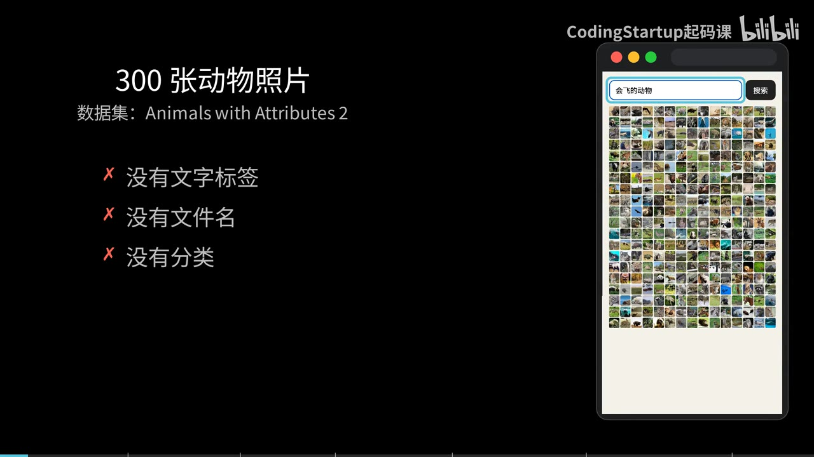
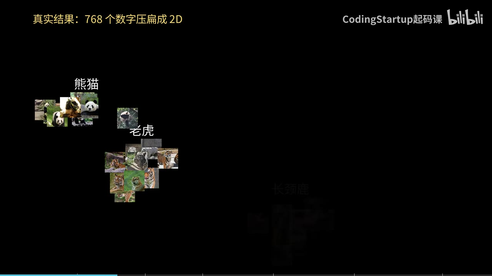
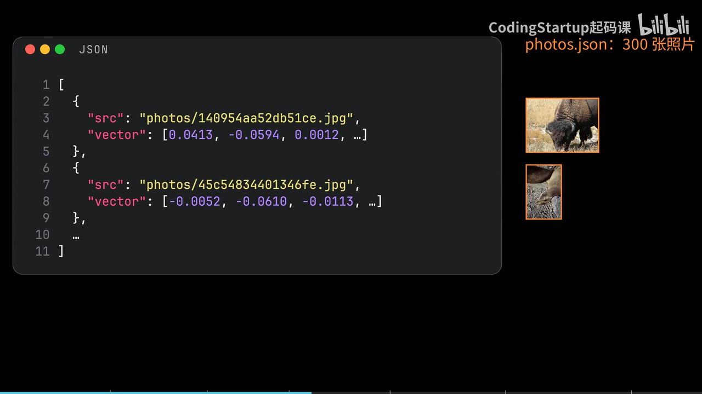
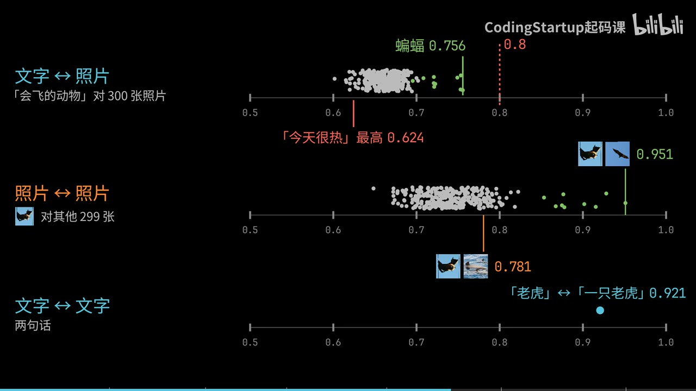
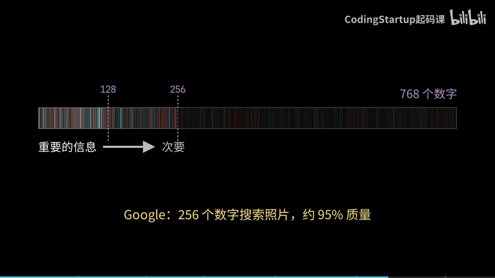

# 一句话搜照片：分数为什么集体偏低，向量又该怎么切短

300 张动物照片，来自一个公开数据集 Animals with Attributes 2。没有文字标签，没有描述性的文件名，也没有分类。输入“会飞的动物”点搜索，前 9 张全是蝙蝠——有的在天上飞，有的倒挂在树上。

第 10 张是一只山猫。换成“黑白色的动物”，出来的是斑马和熊猫，还有一只身上有黑点的豹。每张照片都没附带颜色信息，模型是直接从照片本身看出来的。

做这件事的是 EmbeddingGemma 2：Google 刚开源的多模态 embedding 模型，支持文字、图片、音频和视频，把它们统统变成 768 个数字，放在同一个空间里。这篇只讲文字和图片。所以一句话可以直接和一张照片比较。

先给结论：分数不能直接当门槛，看排名；向量可以切短，但切完要归一化。

## 文字和照片被放进了同一个空间

Embedding 模型会把一句话变成一串数字，意思接近的两句话，它们的数字指向的方向也接近。EmbeddingGemma 2 多做的一件事是：文字和照片各有自己的 encoder，但输出的都是同一个空间里的 768 个数字。

一次真实运行的结果：挑 5 种动物，每种 10 张照片，把每张照片的 768 个数字压扁成 2D 画出来——压成 2D 只是投影示意，聚类是真的，2D 上的距离要用全部 768 个数字算。老虎、熊猫、长颈鹿、海豚和大象各自聚成一堆。

再把 3 句话放进去——老虎、熊猫、长颈鹿，用全部 768 个数字算，每句话最接近的 3 张照片都是对的动物。

要记住那张 2D 图只是示意。真正的距离，要用全部 768 个数字来算。

## 搜索是怎么搭起来的

一个页面，上面一个输入框，下面是 300 张照片。模型装在一台 DGX Spark 上，对外提供一个和 OpenAI 格式相同的 API。

先写一个 `embed` 函数：用 fetch 把请求 POST 到那个地址，body 里放两样东西——`model`，值是 EmbeddingGemma 2 的模型名；`input`，是要转换的文字。返回的 `data` 里第一项的 `embedding` 就是那 768 个数字：0.0092，-0.0368，一直往下。

这串数字的长度是 1。这里的长度指模长，不是数字的个数——模长是 1，两个向量的点积（dot product）就等于 cosine。

照片这边，每张都已经提前交给同一个模型算好了 768 个数字，存在 `photos.json` 里。每一项只有两样东西：照片在哪里，还有它的向量。

里面没有任何文字说明这张照片是什么动物。模型只看照片本身。

页面一打开就 fetch `photos.json`，把 300 张照片显示出来。再写一个 `dot`：一个 for 循环，把两串数字逐位相乘，再加起来——因为模长是 1，这就是 cosine。

点搜索的时候，先把输入的文字 `embed` 成 query，再和每张照片算 `dot`，作为这张照片的 score。然后，只留 score 大于 0.8 的，再从大到小 sort。

## 0.8 这个门槛，一张都过不去

先说清楚：开头那 9 张是去掉门槛后的结果；第一版加上 0.8，一张都没有。

运行，输入“会飞的动物”，搜索结果一张照片都没有。

把 300 张照片的分数放在一条轴上就明白了：最高的一张是蝙蝠，0.756。没有一张超过 0.8，全部挤在 0.6 到 0.76 之间。

再看另外两条轴。同一把尺子上，一句完全无关的“今天很热”，对照片最高也能到 0.624。两张蝙蝠照片之间是 0.951；一张蝙蝠和一张海豚也有 0.781，比正确的文字匹配还高。文字和文字之间，“老虎”和“一只老虎”是 0.921。

原因是文字和照片虽然在同一个空间，但各自聚在不同的区域。可以把这想成两把刻度不同的尺子：它们在同一个空间里，但两类的基准线不同，所以绝对分数不能直接比，顺序才有意义。于是文字对照片的分数会一起偏低。在这个演示里，前 9 名的排名仍然是对的；第 10 名开始出现不相干的结果。

所以不要用一个固定的数字做门槛，看排名就行。去掉过滤，sort 完再跑一次：前 9 张都是蝙蝠，第 10 张是山猫。另搜“在水里游泳的动物”，排在前面的才是河狸、河马、水獭、海豚，还有一只在水里的灰熊。

## 砍掉后面的数字，空间省下三分之二

每张照片 768 个数字，每个数字用 4 字节存，100 万张照片大约要 3 GB。

这个模型训练时会把最重要的信息放在最前面，所以可以只保留前 256 个，甚至前 128 个数字。Google 说，用 256 个数字来搜照片，仍然有大约 95% 的质量。

写一个 `shorten` 函数，用 `slice` 取前 n 个数字。但切短之后，长度就不再是 1 了：前 256 个数字的长度只有 0.709。所以要把每个数字除以这个长度，让它变回 1。

然后 query 和每张照片都用 `shorten` 切到 256 个。768 变成 256，小了 3 倍；100 万张照片从大约 3 GB 变成大约 1 GB。

跑一下：用 256 个数字，排在前面的还是蝙蝠，和 768 个一样。再切到 128 个，前 10 张里松鼠、狐狸和河马挤了进来，蝙蝠只剩下 7 张。

所以切到多短，要拿你自己的数据去试。

## 四件可以带走的事

- 文字和照片在同一个 768 维空间里，所以一句话可以直接搜照片。
- 照片的向量提前算好存下来；搜索的时候只需要 `embed` 一句话，再和每张照片算 `dot`，然后排序。
- 在这个演示里，文字对照片的分数普遍偏低，不要用固定门槛，看排名。
- 想省空间就把向量切短，切完记得把长度除回 1。

想验证这套东西，最直接的办法是换成你自己的照片，输入不同的描述，看它能不能找到。

---

本文根据 B 站视频《Google 昨晚开源 EmbeddingGemma2｜文字和图片在同一个空间｜多模态 Embedding 入门》（UP 主：CodingStartup起码课）整理；画面截取自原视频。
