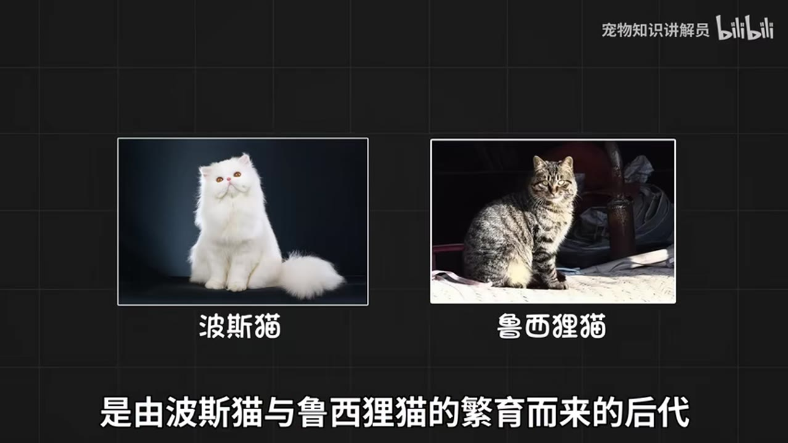
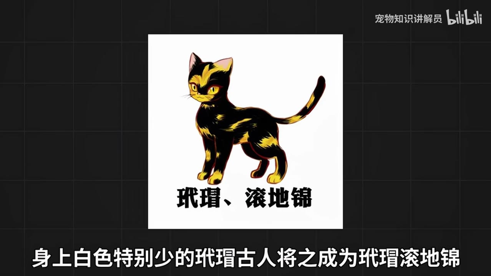

# 橘猫、三花、奶牛猫：这些名字大多说的是长相，不是品种

楼道口那只橘色的猫，路过的人都叫它“大橘”。旁边黑一块白一块的，叫奶牛猫；再远一点，黄、白、黑混在一起的那只，叫三花。这些名字听起来像品种，其实大多是在说它长什么样。三花猫不特指某一品种，黑猫泛指毛色通身黑色的猫。在中国本土猫里，进入过 CFA 登记的只有狸花猫。

这些名字大致分两类：橘猫、三花、奶牛猫、黑猫主要是毛色叫法；狸花猫、狮子猫、简州猫是地方类群。

古人给猫起名，主要看黑和白各长在哪儿；后面有一张黑白位置对照表。

## 狸花猫：中国唯一进过 CFA 登记的猫

狸花猫的名字来自身上的斑纹：棕色或深棕色，左右对称。宋朝就有“狸猫换太子”的故事，这个名字出现得很早。

在猫里，它算高智商；有一种说法是，大致相当于三四岁孩子。跟其他家猫比，它更像一个优雅的猎手：身手矫健，活捉老鼠轻而易举。

它在国内和国外的身价也不一样。在国内很便宜，到了国外，一些猫舍能把它卖到上千元。它是中国本土猫里唯一一种进入过 CFA 登记的中国纯种猫——CFA 是做纯种猫登记的机构。它还有英文名，外国人更喜欢叫它“Dragon Li”，译过来是“狸龙”。

## 橘猫：名字是颜色，胖是真的

俗话讲“十个橘猫九个胖，还有一个压倒炕”。橘猫又名黄狸猫，也叫中国虎斑猫，背上的斑纹很漂亮，多是鱼骨刺和豹点。它大部分是公猫。

吃东西时，它没多少节制：给啥吃啥，吃啥都胖，有人开玩笑说它没有饱腹感，坐着吃、躺着吃、抢着吃。但它肠胃好，适应性强，不容易生病。靠表情包，它成了被很多铲屎官喜欢的田园猫；同时，也是流浪数量较多的猫。

在古代，它一点也不便宜。半橘的猫，古人叫“金背银床”；大橘叫“金丝虎”。

## 古人给猫起名，看的是颜色长在哪儿

奶牛猫是黑猫警长的原型，有个外号叫“喵界神经病”：别的猫都高傲优雅的时候，只有它在犯傻。它的长相忽高忽低，美的时候堪比布偶，丑的时候不忍直视，毛色变化无穷。

正因为变化多，古人给它留了三个名字：

| 长什么样 | 古人叫它 |
|---|---|
| 上黑下白 | 乌云盖雪 |
| 尾巴是黑的 | 雪里拖枪 |
| 只有四只爪是白的 | 踏雪寻梅 |

三个名字说的是同一件事：黑和白各长在哪儿。这套思路不只用在奶牛猫身上：橘猫的“金背银床”“金丝虎”，狮子猫的“尺玉霄飞练”，玳瑁的“滚地锦”，也都是从毛色上取的名字。

## 山东狮子猫的来路，有一种说法

山东狮子猫又叫临清狮子，是中国本土猫里的王者。一种流传的说法是，它来自波斯猫和鲁西狸猫的繁育。

它直鼻梁、下巴强壮，颈毛长得像狮子，名字就是这么来的。主产地在山东省临清市。眼睛多为鸳鸯眼，就是两只眼睛颜色不一样，传说能给人带来好运。

古人管它叫“尺玉霄飞练”。据说季羡林也养过狮子猫。

## 黑猫，和黑里带红的玄猫

黑猫泛指通身黑色的猫。古书记载，黑猫是镇宅辟邪、招财之物；在中国的传统文化里，它寓意吉祥。它和孟买猫长得很像，身体也是漆黑色。

黑猫里还有一种特殊的：玄猫。“黑而有赤色者为玄”，赤就是红，所以玄猫是黑里带红的猫，也叫灵猫。它在古代是辟邪物，一直流传到现在。老话说，每当有灾难降临，它就会出现。

## 三花猫几乎都是母猫

三花猫一般指身上有黄、白、黑三种颜色的猫，不特指某一品种。绝大多数三花猫都是母猫。它的三种颜色分布得很规整，一块一块像拼接起来的，每块之间分界线明显。

玳瑁猫也常被算进三花，但颜色混在一起，没有明显色块分界，像把三种颜料搅在一起，白色可以很少，甚至几乎没有。世界上不存在花纹完全一样的三花。白色特别少的玳瑁，古人叫“玳瑁滚地锦”；白色较多的，叫“玳瑁猴彩霞”。

## 四川简州猫：耳朵像有四只

四川简州猫因产自简州而得名。当地人把它当神猫，用来捕鼠。明清的时候，它是进贡给皇帝的全国四大土特产之一。它毛色驳杂，身形高大，动作异常敏捷。

它还有个名字叫“四耳猫”。所谓四耳，据说是耳朵的轮廓重叠，两大两小，耳中有耳，凑成四只。

## 想养一只，按这些挑

要活泼好动、能捕鼠的，四川简州猫和狸花猫通常比较合适。喜欢胖胖的猫，橘猫就对了。喜欢黑色的，可以看黑猫；喜欢黑里带红的，再考虑玄猫。喜欢长得独特的，可以考虑三花猫和奶牛猫。

挑之前，先想清楚你要的是什么样的猫：能捕鼠的、好抱的，还是看着特别的。橘猫、三花、奶牛这些名字能告诉你它长什么样，但里面没有品种这回事。

---

本文根据 B 站视频（BV1B5411A7ax）整理；画面截取自原视频。
