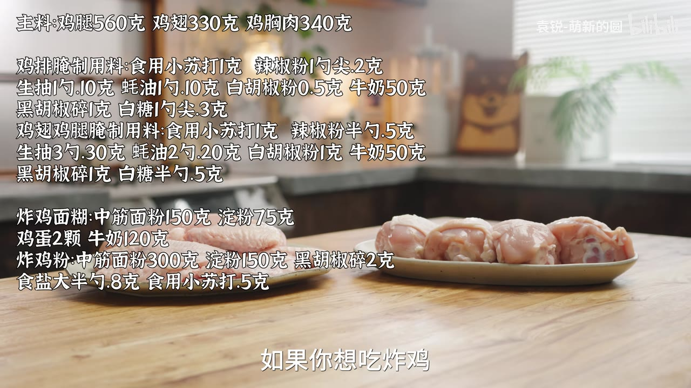
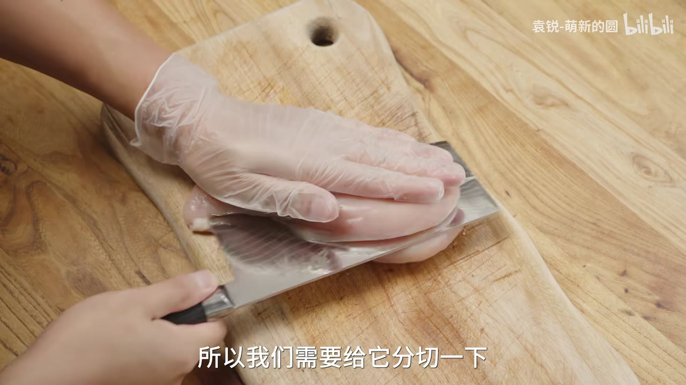
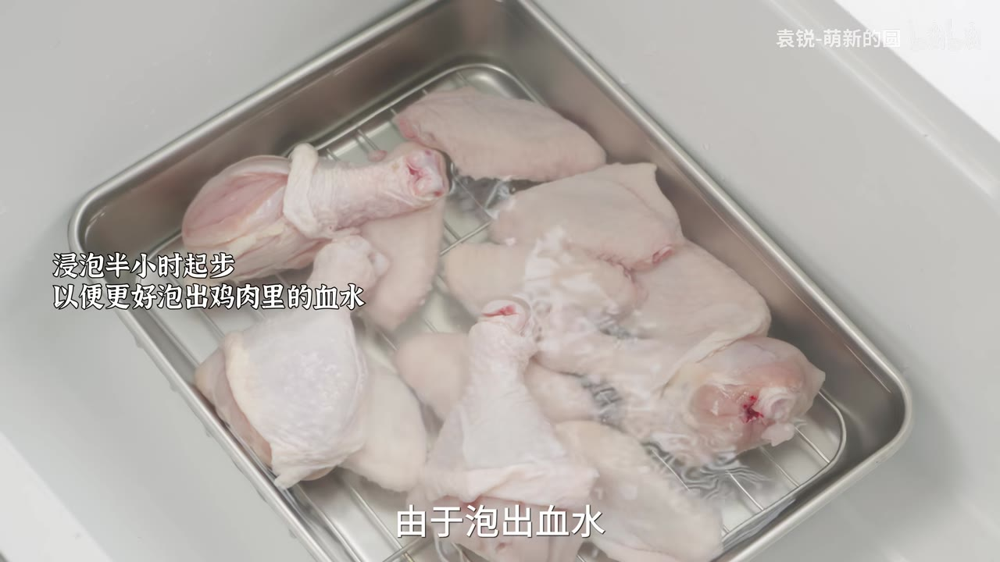
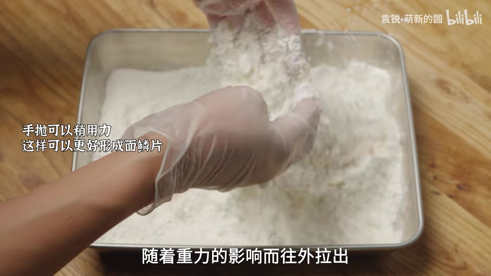
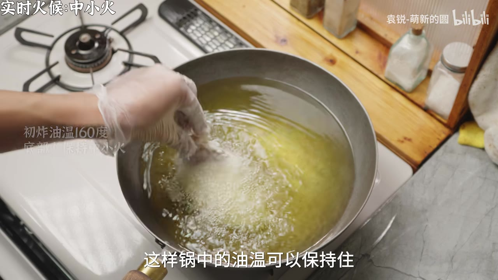
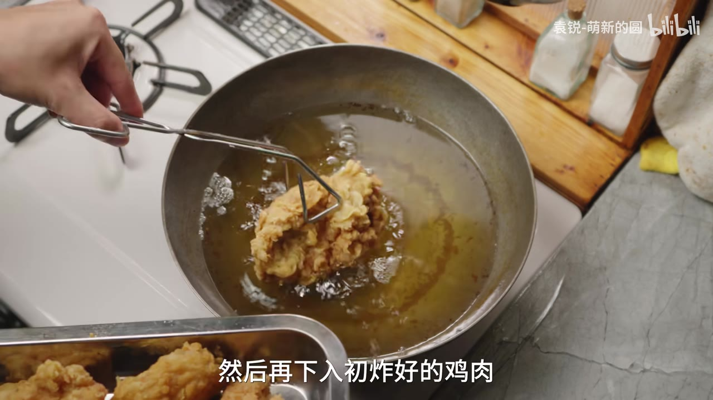

# 炸鸡的鳞片是抛出来的：一份家常脆皮炸鸡

想做炸鸡，最先劝退人的常常是配料表。牛肉粉、大蒜粉、咖喱粉，为了一顿炸鸡买三罐，剩下的放到过期。这套做法大部分用家里常备的东西：面粉、淀粉、鸡蛋、牛奶、生抽、蚝油、小苏打、黑胡椒、盐、糖、辣椒粉和炸油；主要用料按克称好，葱姜蒜等按需增减。鸡翅、鸡腿、鸡排，一次都能炸。

真正决定成败的是三个动作：腌够时间、把鸡块抛起来、两次油温守住（初炸 160℃、复炸 210℃）。配料只是起点。

## 三种肉，三种处理

鸡腿 560 克，是三样里最厚的。竖着打花刀，一是入味，二是炸得快。打的时候把鸡皮往上提一提，花刀打完形状还留得住。

鸡翅 330 克，整个的不用打花刀。怕有腥异味，可以从中间对半切开，血水好出，也更容易入味。

鸡排就是鸡胸肉，340 克。一整块比较大，先从中间对半切开，两片就够——切厚一点能留住更多汁水。再切成小块，方便炸。切好用刀背敲一敲，帮助入味。

鸡翅和鸡腿放进清水里泡半小时到 1 小时，把血水泡出来。味觉不敏感、或者不在意这点腥味的，这一步可以不做。鸡胸肉不用泡——全瘦肉，几乎没有血水也没有异味，切之前简单洗一下就行。

## 先腌鸡排：小苏打和牛奶是做嫩的

趁着鸡翅鸡腿泡水，先把鸡排腌上，单独腌。

1 克食用小苏打，让水分在腌制时更容易进到鸡胸肉里；肉里水多了，吃起来自然嫩滑。接着是辣椒粉 1 勺尖（2 克），增加层次。白胡椒粉去腥增香，黑胡椒碎增加风味、也去腥增香。1 勺尖白糖（3 克）中和味道、提鲜。1 勺生抽（10 克）、1 勺蚝油（10 克），提鲜也提咸——不喜欢蚝油，可以换成等量生抽。最后 50 克纯牛奶，嫩化肉质，再添一点奶香。

抓捏 1 分钟，放进冰箱。最短腌 2 小时；不着急就过夜，调料和水分才有时间进到肉里，鸡排才多汁。这套腌法不只用于炸鸡：健身减脂的，腌好直接放空气炸锅烤就行。

## 鸡翅鸡腿：同一套料，加量，另加葱姜蒜

泡好的鸡翅鸡腿取出来，控干水分或者擦干。表面干一点，腌制时更容易入味。

腌料和鸡排是同一套，多数调料按量增加；小苏打、牛奶、黑胡椒碎维持原量。另外鸡翅鸡腿比鸡排的异味重，要额外加葱姜蒜去腥，不计量，多点少点都行。

| 用料 | 鸡排（鸡胸肉 340 克） | 鸡翅鸡腿（330 克 + 560 克） |
|---|---|---|
| 食用小苏打 | 1 克 | 1 克 |
| 辣椒粉 | 1 勺尖，2 克 | 半勺，5 克 |
| 生抽 | 1 勺，10 克 | 3 勺，30 克 |
| 蚝油 | 1 勺，10 克 | 2 勺，20 克 |
| 白胡椒粉 | 0.5 克 | 1 克 |
| 黑胡椒碎 | 1 克 | 1 克 |
| 白糖 | 1 勺尖，3 克 | 半勺，5 克 |
| 牛奶 | 50 克 | 50 克 |
| 葱姜蒜 | — | 不计量，随意增减 |

调料都放好之后，把葱姜蒜捏碎、捏出汁液，去腥的效果才发挥得出来。抓捏 2 分钟，放进冰箱，时间同样推荐过夜。不太在意的话，鸡翅、鸡排、鸡腿放一起腌也没问题。

## 面糊 1:0.5，炸鸡粉更简单

炸鸡面糊：中筋面粉 150 克、淀粉 75 克，比例 1:0.5。再放鸡蛋 2 颗、牛奶 120 克，混合成面糊，放在旁边备用。克数是给不想自己调配的人，不用那么精确。

炸鸡粉：中筋面粉 300 克、淀粉 150 克、黑胡椒碎 2 克、食盐大半勺（8 克）、食用小苏打 0.5 克，全部混匀就好。淀粉用玉米淀粉或土豆淀粉都行。

很多网上的版本要加牛肉粉、大蒜粉、咖喱粉。家里做一顿炸鸡，不会为了这个买一堆用不上的料，所以这一版在好吃的基础上尽量简化。

## 鳞片是抛出来的

腌好的鸡肉拿出来，鸡排一眼就能看出很嫩、很爆汁。鸡翅鸡腿也放进来，把腌它们的葱姜和牛奶去掉。倒入调好的面糊，混合均匀，让面糊裹住每一块。

裹粉是整件事里最重要的一步：把裹好面糊的鸡块放进炸鸡粉里，再用手把鸡块从粉里抛起来。出鳞片其实很简单，关键是不要用手抓着鸡块往粉里按。抛起来的时候，表面的面糊受重力影响往外拉出，拉出的那一瞬间，最外层的干炸粉就被滴落的面糊包住，鳞片就形成了。一直抛就行，可以稍用力。最后抖一下，把多余的炸粉抖掉。鸡翅、鸡腿、鸡排都这么操作。

## 160℃ 初炸，按部位定时间

油温烧到 160℃。没有测温工具，就拿筷子插进油里，3~4 秒之内浮起一些小泡泡，油温就够了。

初炸期间保持中小火。鸡肉下锅会把油温拉下去，所以一次别下太多，3~4 块就够，锅里的油温才稳得住。下的时候贴着油面往下放，不要扔进去——油温很高，轻一点。

时间按部位分：小块鸡排 6~7 分钟，鸡翅 7~8 分钟，鸡腿最大，12~13 分钟。

## 210℃ 复炸，半分钟之内

炸好的都捞出来。用细漏把锅里的残渣捞一捞，然后开大火，把油温升到 210℃，复炸一遍，外壳更酥脆。

没有测温工具就看锅边：油烧到锅边有点轻微冒烟，这个温度就够了。

复炸时间都一样，半分钟之内，看颜色调整，金黄了就捞出来。

## 哪里可以省

写下来显得步骤多，真做起来很多地方可以简化：

- 泡水去血水，不在意可以不做。
- 鸡翅不打花刀，怕腥才从中间切半。
- 不介意的话，鸡翅、鸡排、鸡腿放一起腌。
- 这套腌法不只用于炸鸡，腌好直接放空气炸锅烤也行。
- 面糊的克数不用精确到个位数，比例对就行。

第一次做，先把三件事做对：腌够时间、把鸡块从粉里抛起来（别用手按）、两次油温守住——初炸 160℃、复炸 210℃。剩下的都能按自己的情况删。

---

本文根据 B 站视频《脆皮炸鸡超详细教程！做法简单巨好吃》（UP 主：袁锐-萌新的圆）整理；画面截取自原视频。
